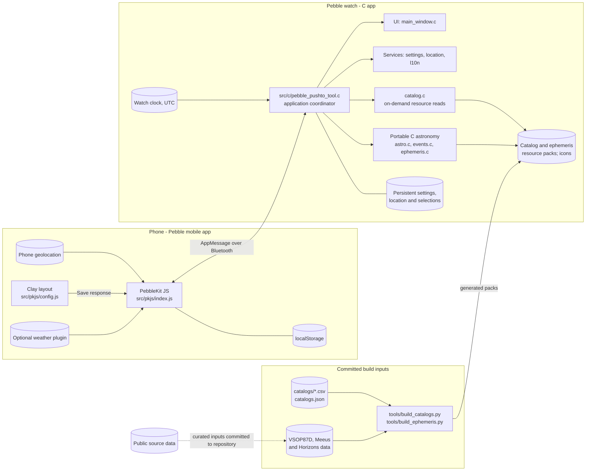
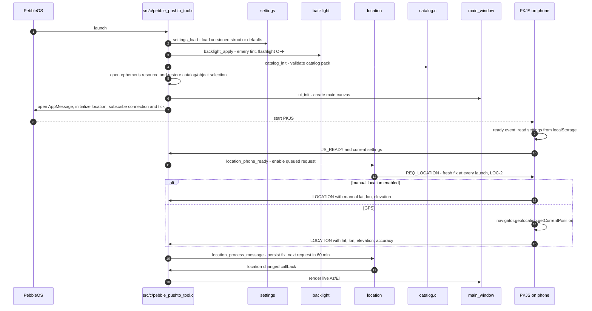
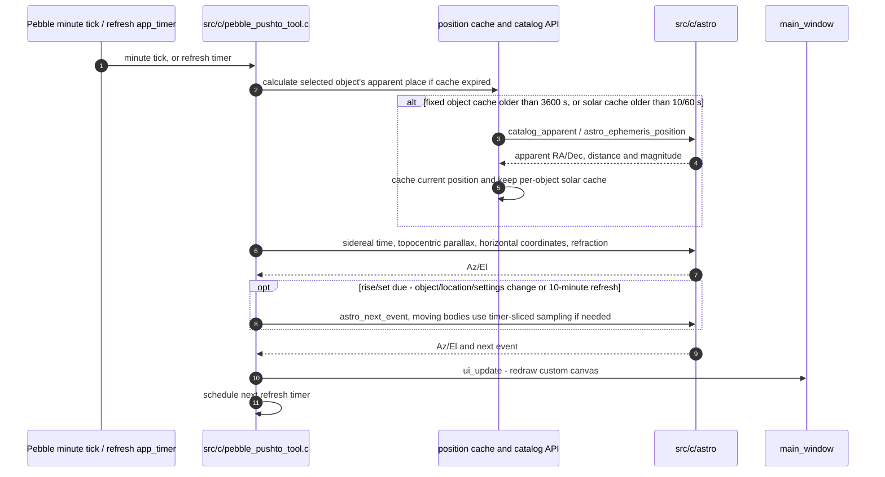
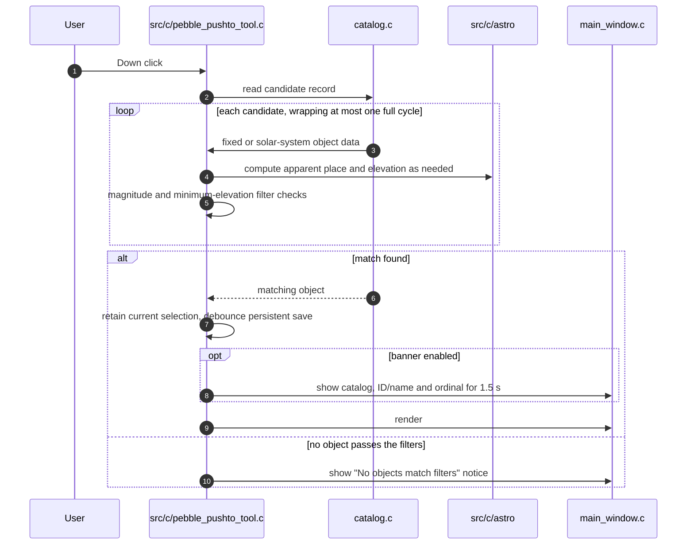
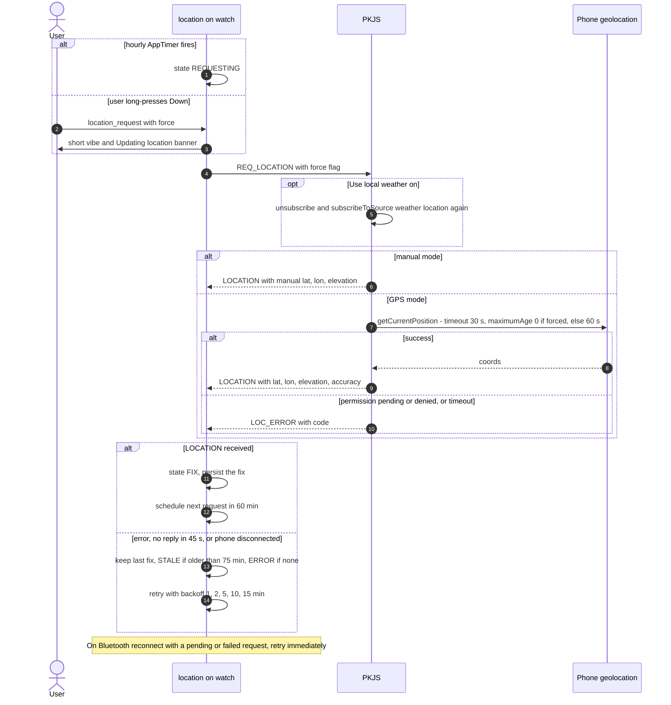
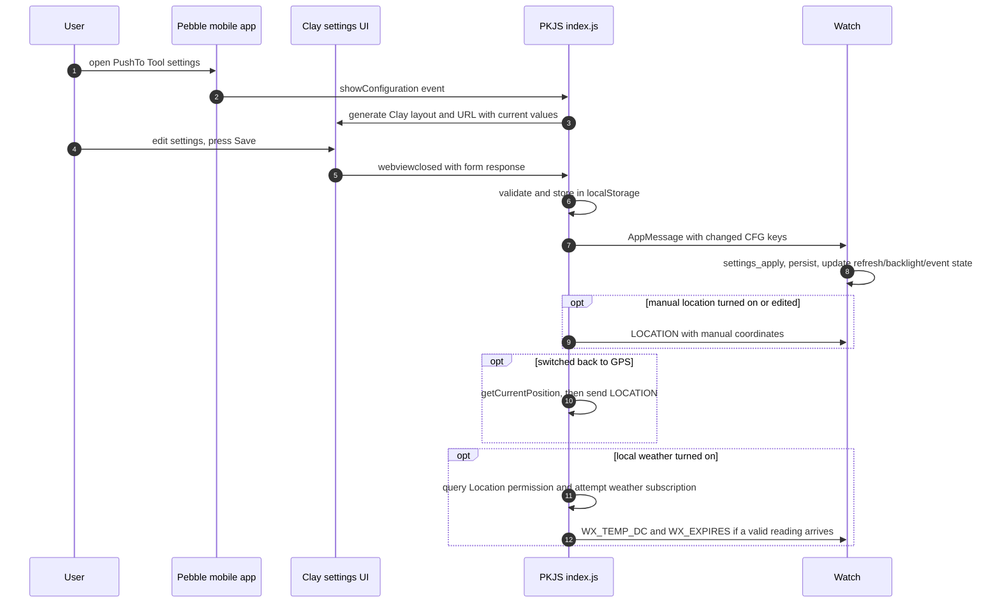
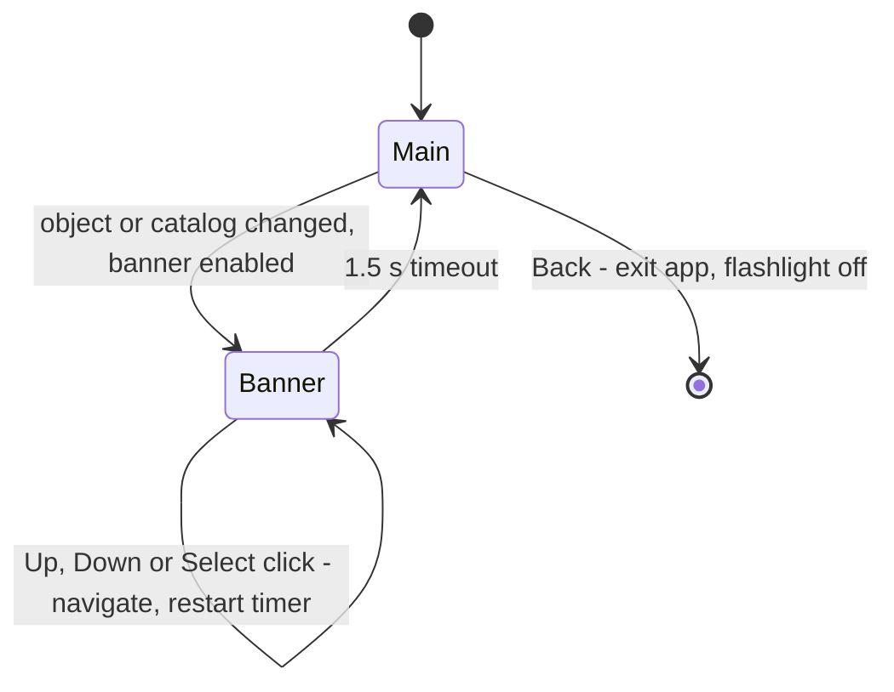
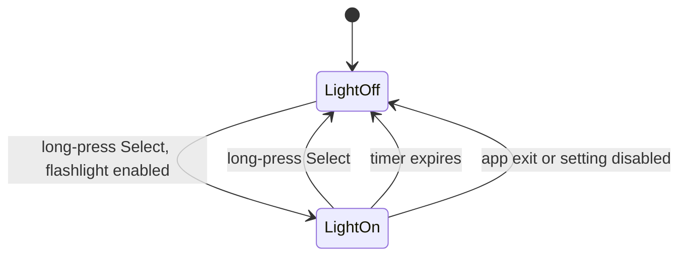
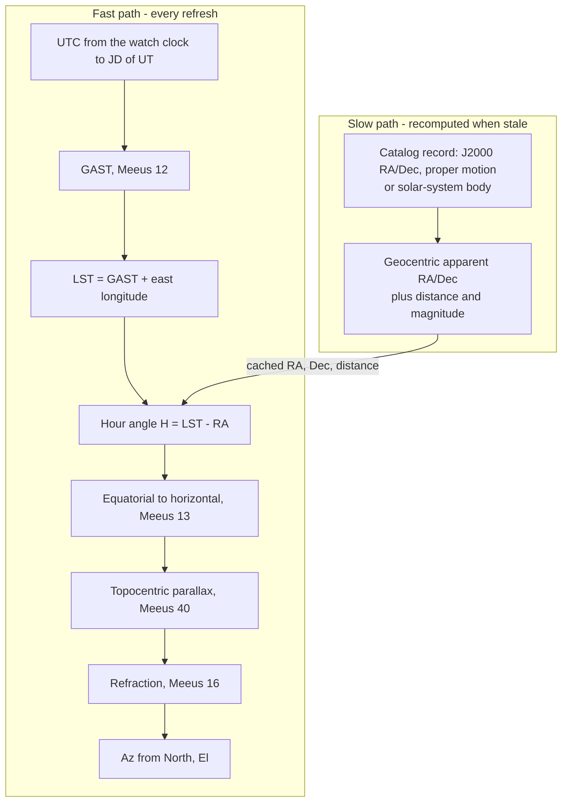

# PushTo Tool — Design and As-Built Document

| | |
|---|---|
| **Status** | Implemented baseline; hardware field validation remains outstanding |
| **Version** | 0.2 |
| **Author** | Sandor Laboratories |
| **License** | Application code: MIT; source acknowledgements: §13 |

Version 0.1 was the reviewed implementation plan. Version 0.2 retains its requirements and
design rationale, but updates architecture, settings, resource formats, measurements and
verification to match the implemented 0.1.0 application. Differences and remaining limitations are
identified explicitly; this is an as-built record, not a change to the original product goals.

---

## Table of Contents

1. [Purpose and Scope](#1-purpose-and-scope)
2. [Requirements](#2-requirements)
3. [Platform Constraints](#3-platform-constraints)
4. [Implementation Decisions](#4-implementation-decisions)
5. [Architecture](#5-architecture)
6. [Behavior and Sequence Diagrams](#6-behavior-and-sequence-diagrams)
7. [Astronomy Algorithms](#7-astronomy-algorithms)
8. [Catalog System](#8-catalog-system)
9. [User Interface](#9-user-interface)
10. [Configuration, Messaging and Persistence](#10-configuration-messaging-and-persistence)
11. [Localization](#11-localization)
12. [Performance, Memory and Power Budgets](#12-performance-memory-and-power-budgets)
13. [Dependencies, Data Sources and Attribution](#13-dependencies-data-sources-and-attribution)
14. [Verification Status](#14-verification-status)
15. [Future Enhancements and Extension Points](#15-future-enhancements-and-extension-points)
16. [References](#16-references)

---

## 1. Purpose and Scope

PushTo Tool is a Pebble watchapp for **visual astronomy in the field with an
altitude–azimuth mount**, such as a Dobsonian telescope. The user selects a
catalog object; the watch continuously displays
its **azimuth and elevation** for the observer's location and current time. The user points the
telescope with an azimuth **setting circle** and an **inclinometer**.

The app does one thing: it tells the user where to point. Everything else is secondary.

### 1.1 Glossary

| Term | Meaning |
|---|---|
| Az | Azimuth, measured in this app from **true North (0°) through East (90°)**, range 0–360°. |
| El | Elevation (altitude) above the horizon, −90°…+90°. Refraction is applied by default. |
| RA/Dec | Right ascension / declination (equatorial coordinates). |
| J2000 | Standard epoch/equinox, JD 2451545.0 (TT). |
| JD / JDE | Julian Day (UT) / Julian Ephemeris Day (TT). |
| ΔT | TT − UT (≈ 69 s in 2026). |
| LST/GAST | Local Sidereal Time / Greenwich Apparent Sidereal Time. |
| PKJS | PebbleKit JS: the app's JavaScript component, which runs inside the Pebble mobile app. |
| Settings page | Clay-generated configuration opened by PebbleKit JS through the app configuration event; settings are submitted with Save. |
| Meeus | Jean Meeus, *Astronomical Algorithms*, 2nd ed. (1998). Cited as `[Meeus Ch. N]`. |
| Flashlight | The backlight held on for a fixed time, toggled by long-pressing Select (UX-11). |

---

## 2. Requirements

Requirement status indicates current implementation: ✅ implemented, ⚠️ implemented with a
limitation or partial deviation, 🔮 future. The tables record the current state; the approved
design intent is retained where it differs.

### 2.1 Platform

| ID | Requirement | Status | Design ref |
|---|---|---|---|
| PLT-1 | Support Pebble Time 2 (**emery**), Pebble 2 Duo (**flint**) and Pebble Round 2 (**gabbro**) | ✅ | §9 |
| PLT-2 | Gabbro may reduce secondary fields, but always shows Az/El | ✅ | §9.4 |
| PLT-3 | Older models are best effort and must not impact the required models | ⚠️ basalt, chalk and diorite supported; aplite not supported | §3.2 |
| PLT-4 | Watchapp written in C | ✅ | §5 |

### 2.2 Astronomy Core

| ID | Requirement | Status | Design ref |
|---|---|---|---|
| AST-1 | All calculations run on the watch, with no phone round-trips | ✅ | §7 |
| AST-2 | Meeus algorithms preferred; references cited in the code and in this document | ✅ | §7, §16 |
| AST-3 | Use hardware acceleration and SDK lookup tables where appropriate | ⚠️ neither is usable: the SDK ABI is soft-float, and the SDK trig lookups are not accurate enough | §3.1 |
| AST-4 | Flag hardware limitations early | ✅ | §3 |
| AST-5 | Algorithm complexity matches the display resolution (≥ 0.1°) | ✅ | §7.9 |
| AST-6 | Astronomy core reusable as a library | ✅ portable C99, no `pebble.h` | §5.3 |
| AST-7 | Support minor-planet positions through 2036 using a precomputed element table; default spacing is 60 days and configurable at build time | ✅ | §7.5 |
| AST-8 | Apply atmospheric refraction by default; use elevation-derived pressure and standard temperature unless an unexpired local weather reading is enabled | ✅ | §7.7 |

### 2.3 Catalogs

| ID | Requirement | Status | Design ref |
|---|---|---|---|
| CAT-1 | Use reliable public data, prefer institutional sources, minimize sources where practical, and use community sources only when institutional data is unavailable; credit all sources | ✅ | §13 |
| CAT-2 | **Sol System**: the Sun first, then the major planets by distance (the Moon takes Earth's place; Pluto counts as major), then the minor planets by distance | ✅ | §8.5 |
| CAT-3 | **Brightest Stars**: the 100 brightest stars, brightest first | ✅ | §8.5 |
| CAT-4 | **Messier**: the 110 objects, in order M1…M110 | ✅ | §8.5 |
| CAT-5 | **IAU Constellations**: the centers of all 88 | ✅ | §8.5 |
| CAT-9 | **RASC Finest NGC**: the 110-object visual observing list | ✅ | §8.5 |
| CAT-6 | Catalogs stored on the watch if they fit | ✅ packed on watch; 9,785-byte catalog pack | §8.3 |
| CAT-7 | Extendable: a catalog file plus a registration step | ✅ CSV + one line in `catalogs.json` | §8.2 |
| CAT-8 | Future: imported files, favorites, observation plans, dynamic catalogs | 🔮 extension points defined | §15 |

### 2.4 Display

| ID | Requirement | Status | Design ref |
|---|---|---|---|
| DSP-1 | Az/El in a large, high-contrast font in the center of the screen | ✅ | §9 |
| DSP-2 | Degrees with at least 0.1° resolution; finer resolution optional where it fits and is accurate | ✅ 0.1° or 0.01° | §9.6 |
| DSP-3 | Az/El is always displayed | ✅ | §9 |
| DSP-4 | An error placeholder is shown when the value is unknown | ✅ `---.-°` | §9.7 |
| DSP-5 | Configurable secondary fields: local time, object ID/name, only the next rise or set, magnitude and optional local temperature | ✅ abbreviated or omitted on smaller screens | §9 |
| DSP-6 | Refresh rate derived from the displayed precision and the object's apparent motion (1 s to 1 min); no user setting | ✅ | §6.2 |
| DSP-7 | Measure azimuth clockwise from true North (0°) through East (90°) | ✅ | §1, §7.6 |
| DSP-8 | Format local and rise/set times using the watch's 12/24-hour setting | ✅ | §9.6 |

### 2.5 Location and Time

| ID | Requirement | Status | Design ref |
|---|---|---|---|
| LOC-1 | Observer position from the phone's GPS through standard Pebble mechanisms | ✅ PebbleKit JS geolocation with the `Location` permission | §3.5, §6.4 |
| LOC-2 | Position refreshed at launch and every hour | ✅ | §6.4 |
| LOC-3 | A standard Pebble icon shows when time or position is unknown | ✅ PebbleOS and Rebble icons | §9.7 |
| LOC-4 | Manual location overrides GPS; off by default; defaults to Greenwich; latitude, longitude and elevation are editable, with a "Use last phone GPS fix" control | ✅ | §10.1 |
| LOC-5 | Provide a map/pin picker for manual location if practical | ⚠️ not provided; manual coordinates are available through LOC-4 | §3.5 |
| LOC-6 | Long-press Down forces a GPS refresh | ✅ | §9.9 |
| LOC-7 | Keep using the persisted location fix until a fresh fix arrives | ✅ | §6.5 |
| LOC-8 | When local weather is enabled, honor the plugin's `validUntilMs` or expire the reading after 3 h if absent; resubscribe at each GPS refresh | ✅ | §3.5, §7.7 |
| TIM-1 | Use the watch clock, synchronized by the Pebble mobile app, as observer time | ✅ | §3.4 |

### 2.6 UX

| ID | Requirement | Status | Design ref |
|---|---|---|---|
| UX-1 | Single purpose, no clutter | ✅ | §9 |
| UX-2 | Black on white by default, with an invert option | ✅ | §9.8 |
| UX-3 | Use Pebble system fonts only; display Az/El in the largest practical, readable font | ✅ per-platform LECO font ladder | §9.5 |
| UX-4 | Red backlight by default where supported (configurable) | ⚠️ emery only (white LED on other models) | §3.3 |
| UX-5 | Option to dim the backlight | 🔮 future; no SDK brightness control | §3.3, §15 |
| UX-6 | Down = next object, Up = previous object, Select = next catalog | ✅ | §9.9 |
| UX-7 | On a change of object or catalog, briefly show the catalog title and the selected object's ID and name in large text (can be turned off) | ✅ | §9.3 |
| UX-8 | Filters set on the phone: minimum elevation and faintest magnitude | ✅ | §8.6 |
| UX-9 | Configure the app in the Pebble mobile app, with an "Advanced" section | ⚠️ implemented with Clay and an explicit Save action, not the proposed bundled `configPage` | §3.5, §10.1 |
| UX-10 | en_US by default; use a localization mechanism | ⚠️ English string lookup exists; SDK locale-framework integration and additional locales are not implemented | §11 |
| UX-11 | Long-press Select toggles a configurable timed flashlight (1, 2, 5 or 10 min; default 5 min). Enabled by default on emery, disabled elsewhere. | ✅ white light on non-emery models | §6.8, §9.9 |
### 2.7 Non-functional (in priority order)

| ID | Requirement | How it is addressed |
|---|---|---|
| NFR-1 | Stable | Host unit tests for the astronomy core; bounded resource reads; no dynamic allocation in hot paths; versioned persisted structs |
| NFR-2 | Maintainable, extendable and modular | Separate UI, services, catalog, ephemeris and portable astronomy modules; orchestration remains in `src/c/pebble_pushto_tool.c` |
| NFR-3 | Human-readable code | Descriptive names and SDK `prv_`/`s_` conventions; not all proposed Doxygen headers were added |
| NFR-4 | Well documented | This document, header documentation, README and CREDITS |
| NFR-5 | Minimal | No background worker, timeline or AppGlance; Clay is used for the configuration UI |
| NFR-6 | Use standard Pebble infrastructure | AppMessage, PebbleKit JS geolocation, persistent storage and Light API |
| NFR-7 | Dependencies listed | §13 |
| NFR-8 | Open source | MIT-licensed application code with source acknowledgements in the app and repository |

---

## 3. Platform Constraints

Constraints are based on SDK 4.44 documentation, platform definitions, build flags and emulator
probe builds.

| Platform | Display | Shape | Colors | App RAM (code + heap) | Backlight | Support |
|---|---|---|---|---|---|---|
| **emery** (Pebble Time 2) | 200×228 | rect | 64 | 128 KB | **RGB** (`PBL_RGB_BACKLIGHT`) | Required |
| **flint** (Pebble 2 Duo) | 144×168 | rect | B/W | 64 KB | White LED | Required |
| **gabbro** (Pebble Round 2) | 260×260 | round | 64 | 128 KB | White LED | Required |
| basalt (Pebble Time) | 144×168 | rect | 64 | 64 KB | White LED | Best effort |
| chalk (Pebble Time Round) | 180×180 | round | 64 | 64 KB | White LED | Best effort |
| diorite (Pebble 2) | 144×168 | rect | B/W | 64 KB | White LED | Best effort |
| aplite (Pebble) | 144×168 | rect | B/W | **24 KB** | White LED | **Not supported** |

### 3.1 ⚠️ No hardware floating point (AST-3)

* The SDK compiles every platform with `-mcpu=cortex-m3 -mthumb`, a soft-float ABI, so the FPU on
  flint, emery and gabbro is not used. Forcing FPU flags would depend on undocumented firmware
  behavior, and these FPUs are single-precision only.
* `libm` is linked by default. Double-precision `sin`, `cos`, `tan`, `asin`, `acos`, `atan2`,
  `fmod`, `sqrt` and `floor`, including the soft-float routines, were estimated at **about 14 KB**
  of code. The implemented app's complete measured footprint is substantially larger; see §12.2.
* The SDK trig lookups were measured on the emulator against double-precision `libm`:

  | Function | Max error |
  |---|---|
  | `sin_lookup` / `cos_lookup` | ≈ 0.0014° |
  | `atan2_lookup` | **0.22°** |
  | Equatorial → horizontal using lookups | **El 0.23°, Az·cos(El) 0.22°** |

  A 0.1° display needs a computational error below 0.05°, so the lookups are not used (D-1). They
  would not save meaningful power either: about 17 µs per tick with `libm`.
* The astronomy core therefore uses double-precision `libm` behind a thin `astro_math` wrapper. The
  caching pipeline (§7.1) keeps the CPU cost negligible, and no work is offloaded to the phone.

### 3.2 ⚠️ Aplite not supported (PLT-3)

Aplite has 24 KB for code and heap and is not in `targetPlatforms`. Basalt, chalk and diorite are
supported, but their measured remaining heap is limited; see §12.2. Their inclusion does not
change the required emery, flint or gabbro targets.

### 3.3 ⚠️ Backlight (UX-4, UX-5, UX-11)

* Only **emery** has an RGB backlight (`PBL_RGB_BACKLIGHT`). The other models have white LEDs, so a
  red tint is not possible on them.
* The Light API (`light_enable_interaction`, `light_enable`, `light_set_color_rgb888`,
  `light_set_system_color`) has **no brightness control and cannot suppress the backlight**. On
  white-LED models only the system settings can disable or dim it.
* On emery the tint is **Red** (default) or **System**. The tint code is compiled only for `PBL_RGB_BACKLIGHT`, and the settings
  page shows the tint only for emery.
* The flashlight (§6.8) uses `light_enable()` with an `AppTimer` and works on every platform. On
  non-emery models it is white, which affects dark adaptation, so it is disabled by default there.
  The app always calls `light_enable(false)` when it exits.

### 3.4 Time source (TIM-1)

* The time source is the **watch clock** (`time()`, UTC), which the Pebble mobile app keeps synced
  with the phone.
* A typical clock error of ≤ 1 s is ≤ 0.004° of sky rotation (§7.9).
* A clock earlier than 2000-01-01 is treated as unset: Az/El shows `---.-°` and the Alarm clock icon
  is displayed.

### 3.5 PebbleKit JS, permissions and settings page (LOC-1, LOC-2, LOC-4, LOC-5, UX-9)

* PebbleKit JS (PKJS) runs only while the watchapp is open, and on iOS its timers do not fire while
  the Pebble mobile app is suspended. The **watch therefore drives the hourly location refresh**
  with an `AppTimer` and a request message (D-9).
* `navigator.geolocation.getCurrentPosition` may return the last known phone position when it
  times out.
* **Permissions.** SDK 4.44 builds use manifest version 2, where an app can use only the
  permissions it declares in `package.json`. The app declares only `Location`:

  ```json
  "usesPermissions": [
    { "name": "Location", "reason": "To compute where objects are in your sky", "required": true }
  ]
  ```

  * Without the `Internet` permission no data can leave the phone, and the Pebble mobile app may
    grant `Location` without an install-time prompt.
  * Until the user answers a permission request, `getCurrentPosition` fails with
    `PERMISSION_DENIED`. The app treats this as temporary and retries (§6.4).
    `Pebble.permissions.query()` distinguishes "prompt" from "denied", and only "denied" is shown
    as "Location denied" on the watch.
  * Emulator testing: `pebble emu-permission Location --deny/--grant/--reset`.
  * **Weather permission and plugin.** The optional "Use local weather" setting subscribes to
    `weather/location` through `Pebble.subscribeToSource` (§7.7). This is separate from standard
    phone geolocation and depends on the Plugins preview being available and enabled. If the
    subscription API or permission is unavailable, no temperature is shown and refraction uses
    10 °C. Invalid or expired readings are also discarded. Standard
    `navigator.geolocation.getCurrentPosition` remains the location mechanism; weather-plugin
    availability does not determine whether that API exists.
  * **Manual location (LOC-4, LOC-5).** No map picker is implemented. Editable latitude, longitude
    and elevation are stored in PKJS `localStorage`; a button can copy the last saved phone GPS fix
    into the fields.
  * **Settings page (UX-9).** The implementation uses `@rebble/clay` 1.1.0, following the later
    decision to use Clay. `package.json` declares the configurable capability, not a `configPage`.
    `src/pkjs/index.js` handles `showConfiguration`, builds the layout from `src/pkjs/config.js`,
    opens it with `Pebble.openURL(clay.generateUrl())`, then reads the response on `webviewclosed`.
    The page has a **Save** action. PKJS validates and stores values in `localStorage`, sends
    watch-relevant settings over AppMessage, and responds to manual-location changes. Help text
    explains non-obvious controls, including refraction.

### 3.6 Fonts (UX-3)

Only the LECO numeric system fonts have monospaced digits together with `.` and `°`, so values do
not shift sideways as they change. Measured widths of `"359.9°"`: LECO 42 is 135 px and LECO 38 Bold
is 124 px. `FONT_KEY_BITHAM_42_BOLD` has proportional digits, and
`FONT_KEY_ROBOTO_BOLD_SUBSET_49` lacks `.` and `°`. The per-platform choice is in §9.5.

### 3.7 Buttons (UX-6, UX-11, LOC-6)

All gestures use the standard `window_single_click_subscribe` and `window_long_click_subscribe`
handlers (long-click delay 700 ms). With a long-click handler registered, the SDK delivers either
the single click or the long click, never both.

### 3.8 Storage and other limits

* Persistent storage is **1 MB per app** on flint, emery and gabbro (4 KB on older platforms).
* App resources can be up to **256 KB**.
* The SDK `snprintf` does not support `%f`, so numbers are formatted with fixed-point integer code
  (§9.6).

---

## 4. Implementation Decisions

Requirements are in §2; this section records implementation choices and rationale.

| ID | Implementation choice | Alternative | Rationale |
|---|---|---|---|
| D-1 | Double-precision `libm` (soft-float) | SDK lookups; fixed point; FPU | SDK lookup errors exceed the 0.1° display budget; complete-app memory use is measured in §12.2. |
| D-2 | Truncated VSOP87D for Sun and planets [Meeus Ch. 32] | JPL approximate elements | JPL elements omit Pluto and have up to 0.17° error; the measured complete ephemeris resource is about 109 KB (§7.5). |
| D-3 | Meeus Ch. 47 abridged ELP-2000/82 for the Moon, with topocentric parallax | Lower-precision lunar model | About 10″ accuracy; parallax is essential for pointing (§7.5). |
| D-4 | Meeus Ch. 37 for Pluto | Keplerian elements | About 1″ accuracy within 1885–2099 (§7.5). |
| D-5 | Two-body Kepler propagation from JPL Horizons elements for minor planets (AST-7) | One element set per release; phone-supplied positions | A single set drifts by about 0.1° within months; a table supports on-watch computation (§7.5). |
| D-6 | Sæmundsson refraction model (AST-8) | No refraction; standard conditions | Corrects apparent altitude; pressure derives from elevation, with optional weather temperature (§7.7). |
| D-7 | Compile CSV catalogs into one packed binary resource | C arrays; on-watch JSON parsing | Keeps catalog data in resources and reads records on demand (§8.3). |
| D-8 | Two catalog provider kinds, dispatched by `catalog.c` | A generic function-table interface | Fixed and solar-system records share the catalog API; new kinds currently require C changes (§5.3, §8.4). |
| D-9 | Watch-driven location refresh (LOC-2) | PKJS `setInterval` | PKJS timers may be suspended on iOS (§3.5). |
| D-10 | PebbleOS and Rebble status icons from Pebble iconography | Custom icons | Uses established Pebble ecosystem icons (LOC-3, §9.7). |
| D-11 | LECO with a per-platform font ladder (UX-3) | Other system fonts; bundled font | Monospaced digits stay aligned without adding font resources (§3.6, §9.5). |

---

## 5. Architecture

### 5.1 System context



### 5.2 Watch module architecture (layered)

The implementation has distinct UI, service, catalog and astronomy modules, but the original
separate application-controller, layout, banner-layer, resource-reader and provider modules were
not created. `src/c/pebble_pushto_tool.c` coordinates app state, navigation, timers,
calculations and service callbacks. The astronomy files are portable C and do not
include `pebble.h`.

```
┌───────────────────────────────────────────────────────────────────┐
│ APPLICATION COORDINATION   src/c/pebble_pushto_tool.c              │
│ state · navigation · tick/event/location callbacks · timers         │
├───────────────────────────────────────────────────────────────────┤
│ UI                         src/c/ui/main_window.c                   │
│ custom canvas · layouts · banners                                   │
├───────────────────────────────────────────────────────────────────┤
│ SERVICES                   src/c/services/                          │
│ settings · location · English strings                              │
├───────────────────────────────────────────────────────────────────┤
│ CATALOG                    src/c/catalog/catalog.c                  │
│ catalog pack decoding · fixed/solar-system record dispatch          │
├───────────────────────────────────────────────────────────────────┤
│ ASTRONOMY                  src/c/astro/                             │
│ coordinates · ephemeris · events · refraction · rise/set             │
│ portable C; no Pebble headers                                        │
└───────────────────────────────────────────────────────────────────┘
                      │ resource reads
                      ▼
             catalogs.bin / ephemeris.bin
```

The watch coordinator depends directly on the modules it orchestrates:

| From | Uses |
|---|---|
| `src/c/pebble_pushto_tool.c` | `main_window`, settings, location, catalog API, astronomy API, Pebble timer/messaging/backlight APIs |
| `ui/main_window.c` | screen-state struct, localization strings, Pebble graphics/layer/window APIs |
| `catalog/catalog.c` | catalog pack resource reader and astronomy ephemeris functions |
| `astro/ephemeris.c` | bounded callback-based reads from the ephemeris resource |

### 5.3 Module responsibilities

| Module | Responsibility | Key API (sketch) |
|---|---|---|
| `src/c/pebble_pushto_tool.c` | `main()` and app coordinator: loads settings/resources, retains selection and calculation state, handles button/tick/AppMessage/connection events, filters, banners, flashlight and rise/set scheduling | `main()`, internal init/deinit and event handlers |
| `src/c/ui/main_window.c` | Draws the main screen and temporary banners in a custom canvas, and loads icons | `ui_init()`, `ui_update()` |
| `src/c/services/settings.c` | Settings defaults, validation, persistence and updates from AppMessage | `settings_load()`, `settings_apply()` |
| `src/c/services/location.c` | Persisted fix, request lifecycle, timeout/retry/hourly timers, connection handling and warning state | `location_init()`, `location_request()`, `location_observer()` |
| `src/c/services/l10n.c` | Small English string table | `l10n(StringId)` |
| `src/c/catalog/catalog.c` | Reads catalog directory/records on demand, decodes fixed/body entries, dispatches to fixed-object or solar-system calculations | `catalog_init()`, `catalog_open()`, `catalog_object()`, `catalog_apparent()` |
| `src/c/astro/astro.c` | Julian dates, ΔT, sidereal time, fixed-object apparent place, horizontal coordinates, parallax and refraction | `astro_*()` |
| `src/c/astro/ephemeris.c` | VSOP87D, Moon, Pluto and minor-body calculations from a callback-read binary resource | `astro_ephemeris_init()`, `astro_ephemeris_position()` |
| `src/c/astro/events.c` | Rise/set calculation and moving-object search/interpolation | `astro_next_event()` |

### 5.4 Source tree (implemented)

```
Pebble-PushTo-Tool/
├── docs/DESIGN.md
├── README.md, CREDITS.md, LICENSE, LICENSES/
├── package.json, package-lock.json, wscript
├── catalogs/                         ← CSV data and catalogs.json registration order
├── ephemeris/
│   ├── vsop87d/                       ← committed compressed VSOP87D inputs
│   ├── meeus/                         ← committed Moon and Pluto term CSVs
│   └── minor_planets.csv              ← committed JPL Horizons elements
├── tools/                             ← catalog/ephemeris builders and source fetchers
├── resources/generated/               ← generated packs and catalog credit files
├── resources/icons/                   ← platform-size status/flashlight icons
├── src/c/
│   ├── pebble_pushto_tool.c            ← main entry point and application coordinator
│   ├── ui/main_window.[ch]
│   ├── services/{location,settings,l10n}.[ch]
│   ├── catalog/catalog.[ch]
│   └── astro/{astro,events,ephemeris}.[ch]
├── src/pkjs/
│   ├── index.js                        ← location/weather, Clay lifecycle and AppMessage
│   └── config.js                       ← Clay settings layout and help text
└── test/
    ├── astro/                          ← host C tests, including JPL Horizons vectors
    ├── tools/                          ← Python builder/fetcher tests
    └── pkjs/                            ← companion JavaScript tests
```

### 5.5 Coding conventions

* C99 with the SDK's warnings-as-errors (`-Wall -Wextra -Werror`).
* SDK style: `prv_` prefix for file-local (`static`) functions and `s_` for file-local state. Each
  module has a public prefix (`astro_`, `ephem_`, `catalog_`, `location_`, …).
* Every astronomy function has a Doxygen header giving units and the source reference, for example
  `/** ... @ref Meeus Ch. 13, eq. 13.5–13.6 */`.
* Inside `astro/`, angles are radians; inputs and outputs in degrees use `*_deg` names. Longitude
  is **east-positive** throughout. Meeus uses west-positive, and every conversion point documents
  this.
* No heap allocation in `astro/`. The app allocates only at window load.

---

## 6. Behavior and Sequence Diagrams

### 6.1 App startup



### 6.2 Adaptive refresh timer and minute tick



Refresh interval (issue #16):

* The guidance readout only has to stay within half a display step of the true value: 0.05° at
  0.1° precision, 0.005° at 0.01°. Stars, planets and DSOs move at most about 0.25°/min (0.004°/s)
  in alt/az, but azimuth speeds up as 1/cos(El) near the zenith.
* Each recompute also evaluates the horizontal position at `now + 1 s` (positions are computed, not
  measured, so there is no noise to filter) and takes the larger of the azimuth (wrapped) and
  altitude change as the rate. The next `app_timer` fires after
  `clamp(budget / rate, 1 s, 60 s)`, rounded down to whole seconds.
* Typical results: about 12 s at 0.1° and 1 s at 0.01°; 1 s near the zenith. With no location the
  interval is 60 s.
* The OS `MINUTE_UNIT` tick refreshes the clock, weather expiry and rise/set checks, recomputes the
  position and reschedules the timer, so nothing wakes every second. Selecting an object or
  changing settings also recomputes and reschedules immediately.
* The legacy `refresh_seconds` settings byte is kept as reserved and ignored. A future fast-moving
  catalog (satellites, #17) will need a sub-second floor or per-object override.

### 6.3 Object and catalog navigation (with filters and banner)



Select (next catalog) and Up (previous object) follow the same flow.

### 6.4 Location refresh



### 6.5 Location state machine

```mermaid
stateDiagram-v2
    [*] --> MISSING: no persisted fix
    [*] --> ACQUIRING: persisted fix loaded; fresh fix not yet received
    MISSING --> ACQUIRING: launch / request
    ACQUIRING --> VALID: valid LOCATION message with known altitude
    ACQUIRING --> WARNING: valid fix without altitude
    ACQUIRING --> ERROR: error or timeout and no usable fix
    ACQUIRING --> WARNING: error or timeout while a fix exists
    VALID --> ACQUIRING: hourly timer or long-press Down
    VALID --> WARNING: fix older than 75 min
    WARNING --> ACQUIRING: retry timer, reconnect or long-press Down
    ERROR --> ACQUIRING: retry timer, reconnect or long-press Down
```



**Persisted fix (LOC-7).** A fresh fix is requested at every launch (LOC-2). Until it arrives, the
last persisted fix is used, so Az/El is shown immediately and the app keeps working when the phone
is out of range. While a request is pending, the Location icon is shown. A fix older than 75 minutes
or one without a known altitude is marked with the Warning icon; unknown GPS altitude is treated as
sea level. There is no separate 12-hour "Old location" state.

| State | Az/El | Status icon |
|---|---|---|
| MISSING / ACQUIRING (no fix) | `---.-°` | Location icon while requesting (shown steadily while requesting); otherwise location problem. Rect screens show a short reason. |
| ACQUIRING with a persisted fix | live from saved fix | Location icon until a new fix arrives |
| WARNING | live from saved fix | Warning icon; fix age > 75 min or GPS altitude unknown |
| VALID | live | No location icon |
| Clock before 2000-01-01 or invalid | `---.-°` | Alarm clock icon |

### 6.6 Configuration change



If the `Location` permission is `"prompt"`, the weather subscription may trigger the mobile app's
permission flow. A denied permission leaves the setting on, but PKJS skips the subscription and
sends `WX_CLEAR`, so refraction uses 10 °C. The settings page shows a warning. Details are in §3.5.

### 6.7 UI modes



### 6.8 Flashlight (UX-11)



Long-pressing Select while the flashlight setting is disabled does nothing.

* **LightOff → LightOn:** `light_enable(true)`, start an `AppTimer` for the configured duration, short vibe.
* **LightOn → LightOff:** `light_enable(false)` and cancel the timer. A manual toggle also gives a short vibe.
* While the flashlight is on, the flashlight indicator (the PebbleOS Backlight icon, §9.7) is shown
  in the status row.
* Other buttons keep their normal functions while the flashlight is on.
* On emery, the light uses the configured tint.

---

## 7. Astronomy Algorithms

All algorithms are in `src/c/astro/`, use **double** precision, and cite their sources in the code.
Time arguments are **JD(UT)** for Earth rotation and **JDE(TT)** for ephemerides.

### 7.1 Pointing pipeline (two-rate)

The expensive part, the apparent RA/Dec, changes slowly. The app coordinator caches the selected
object's apparent position and uses a separate 14-entry solar-system cache. It recomputes
horizontal coordinates at the adaptive refresh interval (§6.2):



| Body type | Slow-path validity (recompute interval) | Worst-case motion in that interval |
|---|---|---|
| Stars, Messier, constellations | 60 min | < 0.0002° (nutation/aberration drift) |
| Sun, planets, Pluto, minor planets | 60 s | Sun ≈ 0.0007°; fastest planet (Mercury) < 0.0015° |
| Moon | 10 s | ≈ 0.0015° |

Selecting a different catalog object changes the current position cache. Observer changes do not
invalidate geocentric RA/Dec because observer parallax and horizontal coordinates are applied
afterward.

### 7.2 Time [Meeus Ch. 7, 10]

* `JD(UT) = 2440587.5 + unix_seconds / 86400`, using UTC in place of UT1. |DUT1| < 0.9 s, which
  is at most 0.004°.
* `JDE = JD(UTC) + (TT−UTC)/86400`, using a fixed TT−UTC offset of 69.184 s (TAI−UTC = 37 s,
  TT = TAI + 32.184 s). Leap seconds are intentionally not tracked: the most recent was inserted
  at the end of 2016-12-31, and none have been announced since. CGPM Resolution 5 (2026)
  establishes continuous UTC effective 2027-05-20, with maximum |UT1−UTC| of 3,600 s
  ([resolution](https://www.bipm.org/en/cgpm-2026/resolution-5)). Before then, an announced leap
  second in [IERS Bulletin C](https://hpiers.obspm.fr/iers/bul/bulc/bulletinc.dat) would require
  updating the offset. This is a live display, not a historical tool: historical dates are
  unsupported, setting the watch clock backwards is at the user's own risk, and dedicated tools are
  better suited to historical research.
* `T = (JDE − 2451545.0) / 36525` (Julian centuries). VSOP87 uses millennia, `τ = T/10`.

### 7.3 Sidereal time [Meeus Ch. 12]

* GMST from eq. 12.4 (the IAU 1982 expression in JD(UT)).
* GAST = GMST + Δψ·cos ε (equation of the equinoxes, using nutation from §7.4).
* LST = GAST + λ, with longitude λ east-positive. **Meeus uses west-positive longitude. The
  conversion is done once, in `astro_sidereal_local()`.**

### 7.4 Fixed objects: J2000 → apparent place

For stars, Messier objects and constellation centers:

1. **Proper motion** (linear; stars only): `α += μα*/cos δ · t` and `δ += μδ · t`, with t in years
   since J2000.0. The largest effect in the catalog is about 0.03° (α Cen).
2. **Precession**, rigorous ζ, z, θ [Meeus Ch. 21, eq. 21.2–21.4]. About 0.36° by 2026, so it is
   **mandatory**.
3. **Nutation** in longitude and obliquity (Δψ, Δε), using the low-precision 4-term form
   [Meeus Ch. 22, p. 144], good to about 0.5″. True obliquity ε from eq. 22.2.
4. **Annual aberration** [Meeus Ch. 23, eq. 23.3], using the Sun's true longitude from the
   low-precision formula [Meeus Ch. 25]. Up to 20″.
5. Nutation applied to α and δ [Meeus eq. 23.1].

On the 64 KB targets, `ASTRO_LOW_MEMORY` omits annual aberration and nutation corrections but
still computes mean obliquity for coordinate rotations. Host comparisons across four epochs and a
full-sky star grid observed a maximum 0.010370° difference (stars); the low-memory app therefore
uses 0.1° display precision even if the 0.01° option is selected. Emery and Gabbro retain the
full-accuracy path.

Annual parallax (< 1″) and light deflection by the Sun are ignored.

### 7.5 Solar-system bodies

| Body | Method | Reference | Expected accuracy |
|---|---|---|---|
| **Sun** | Earth's heliocentric L, B, R from VSOP87D, inverted, then FK5 correction, nutation and aberration (−20.4898″/R) | [Meeus Ch. 25 "higher accuracy", Ch. 32] | ~1″ |
| **Mercury … Neptune** | VSOP87D heliocentric L, B, R for the planet and for Earth → geocentric rectangular, with **light-time iteration**, FK5 correction, nutation and aberration | [Meeus Ch. 32, 33]; Bretagnon & Francou (1988) | ≤ 5″ (truncation target 1″ heliocentric) |
| **Moon** | Meeus Ch. 47: the first 54 of 60 longitude/radius terms and 54 of 60 latitude terms, plus A1–A3 additive terms and the E eccentricity factor; the coefficient tables are stored in `ephemeris.bin` and streamed in batches of at most four | [Meeus Ch. 47]; coefficient transcription from Sonia Keys' MIT-licensed `meeus` implementation | ~10″ in longitude, ~4″ in latitude; truncation adds less than 0.002° in apparent position |
| **Pluto** | 43-term periodic series, heliocentric J2000 → geocentric with light-time, then precession to the date; coefficients are stored in `ephemeris.bin` and streamed in batches of at most four | [Meeus Ch. 37]; coefficient transcription from Sonia Keys' MIT-licensed `meeus` implementation | ~1″. **Valid 1885–2099 only**; outside that range calculation returns unavailable. |
| **Vesta, Juno, Ceres, Pallas** | Two-body Kepler orbit from **JPL Horizons osculating elements** (epoch, a, e, i, Ω, ω, M), taken from a compile-time table with one element set **every 60 days for ~10 years** (2026–2036; the spacing is a build parameter). The set with the nearest epoch is used. Kepler's equation is solved by Newton iteration [Meeus Ch. 30], then J2000 ecliptic → equatorial, light-time, precession and nutation. | [Meeus Ch. 30, 33] | With at most 30 days from the epoch: about 1″–10″ (to be measured against Horizons). After the table ends, accuracy decays (see below). |

`ASTRO_LOW_MEMORY` also omits nutation and annual aberration for solar-system apparent places;
mean obliquity remains in use. In the host comparison grid the maximum observed differences were
0.009872° for the Sun, 0.004859° for the Moon, 0.009757° for planets, 0.009480° for Pluto and
0.010179° for minor planets. Across the sky grid and all listed bodies the maximum was 0.010370°,
below the low-memory build's 0.1° display step. These are sampled maxima, not a bound for every
date or position. The sampled rise/set events changed by at most 42.19 seconds.

**Minor-planet element table.** Osculating elements describe the two-body orbit at one instant;
planetary perturbations (mainly Jupiter) make the real orbit drift from it, reaching about 0.1°
within months. `tools/fetch_ephemeris.py` takes element sets from JPL Horizons at a fixed spacing, and
`build_ephemeris.py` stores them in `ephemeris.bin` (four bodies × 68 epochs × 56 bytes = 15,232
bytes in the current build). The fetch script accepts `--epoch-step-days` (default **60**) and
`--end-year` (default 2036). The spacing and epoch count are stored in the resource header, so the
watch does not need code changes when the table is rebuilt. The table stays in resource flash.
When a minor planet is selected, only the nearest 56-byte record is read with
`resource_load_byte_range`. Outside the table's epochs, the nearest endpoint is used and the
calculation is flagged/logged; the phone settings About page reports the nominal 2026–2036
coverage.

**Topocentric parallax** [Meeus Ch. 40] is applied in the fast path. It uses the observer's
ρ sin φ′ and ρ cos φ′ (from latitude and elevation, Ch. 11) and the body's distance Δ. It matters
mainly for the **Moon (up to ~1°)**. For the Sun and planets it is below 9″, but it is applied for
consistency.

**VSOP87 truncation.** `tools/build_ephemeris.py` reads the official VSOP87D files (VizieR VI/81)
and drops terms below an amplitude threshold set per series. The goal is ≤ 1″ heliocentric over
1900–2100. The tool reports the resulting term counts and the maximum error compared with the full
series. The estimate is about 1,000–1,500 terms in total, which is about 24–36 KB as `double`
triples (A, B, C) in `resources/ephemeris.bin`. terms are **streamed** from the resource in batches of four into a stack buffer, so RAM use does
not depend on series length. The current ephemeris resource also contains Moon and Pluto terms.
Its exact format and size are documented in §8.3.

**Moon-series truncation.** The same generator retains the first 54 rows of each Meeus Ch. 47
Moon table on every platform; the version-2 resource header carries the resulting counts, which
the runtime already uses for its streaming loops. The six-row suffix is omitted from both tables.
Across 1900–2100, the omitted absolute coefficient sums are bounded by 0.001578° in longitude
and 0.000805° in latitude after allowing for the largest E factor in that interval. Their
root-sum-square bound is 0.001772°, below the 0.002° all-platform decision threshold. The omitted
radius coefficient absolute sum is at most 9.923 km. Including the largest topocentric parallax
amplification at lunar perigee gives a conservative apparent-position bound below 0.00184°. We
retain all terms on no platform-specific path: the measured apparent-position error is well below
the 0.01° display step, and this avoids introducing a second build variant or shared macro.

The host regression compares the generated truncated resource with a full-series reference:
daily ecliptic samples cover 1900–2100; daily apparent and topocentric samples cover 2026–2036
at Greenwich and in Chile; next Moon rise/set events are compared every 30 days at both sites.
The date ranges correspond to the precision interval used for the VSOP series and the minor-body
element table, respectively. Max/RMS absolute differences were:

| Output | Maximum | RMS |
|---|---:|---:|
| Ecliptic longitude | 0.001566° | 0.000498° |
| Ecliptic latitude | 0.000724° | 0.000235° |
| Geocentric distance | 9.920 km | 6.235 km |
| Apparent position | 0.001488° | 0.000544° |
| Topocentric pointing | 0.001498° | 0.000544° |
| Topocentric altitude | 0.001412° | 0.000365° |
| Topocentric azimuth, below 89° altitude | 0.007650° | 0.000603° |
| Phase angle | 0.001490° | 0.000483° |
| Illumination fraction | 0.0000128 | 0.0000030 |
| Lunar magnitude | 0.000145 mag | 0.000044 mag |
| Moon rise/set time | 0.49 s | 0.14 s |

Azimuth is not compared near the zenith, where it is undefined/ill-conditioned. Rise/set sampling
uses two non-polar sites; grazing events near a polar boundary have no finite universal timing
bound. The sampled Moon phase and illumination changes are below watch display precision.

### 7.6 Equatorial → horizontal [Meeus Ch. 13]

```
tan A_s = sin H / (cos H · sin φ − tan δ · cos φ)     (A_s from South, Meeus)
sin h   = sin φ · sin δ + cos φ · cos δ · cos H
A_N     = (A_s + 180°) mod 360°                        (azimuth from North, DSP-7)
```

`atan2` resolves the quadrant. At the zenith (|h| > 89.99°) azimuth is undefined. In that case the
display keeps the last azimuth. The affected region is a 0.01° cap.

### 7.7 Atmospheric refraction [Meeus Ch. 16]

The Sæmundsson formula (eq. 16.4) converts true altitude to apparent altitude:
`R[′] = 1.02 / tan(h + 10.3/(h + 5.11))`, with h in degrees, for 1010 hPa and 10 °C. It is scaled
for local conditions by `P/1010 × 283/(273 + T)` [Meeus Ch. 16, p. 107]:

* **Pressure P** is derived from the observer's elevation with the standard-atmosphere barometric
  formula, `P = 1013.25 · (1 − 2.25577·10⁻⁵ · h_m)^5.25588` hPa. At 1500 m this reduces refraction
  by about 16% (≈ 0.09° at the horizon).
* **Temperature T** is 10 °C unless "Use local weather" is on. Then PKJS subscribes to the Plugins
  `weather/location` source (`Pebble.subscribeToSource`), reads `temperature` from the first
  instance, and sends `WX_TEMP_DC` (in °C), `WX_TEMP_UNIT` (the unit the user chose for weather in
  the Pebble mobile app) and `WX_EXPIRES` with every update. The same reading is shown in the status
  bar (§9.2).
  * **Refresh.** The weather plugin decides how often it sends updates (its
    `suggestedRefreshIntervalSec`); the SDK gives the subscriber no interval or force-refresh
    control. PKJS also unsubscribes and subscribes again at every location request (launch, hourly
    and long-press Down, §6.4), which gives the plugin a chance to send newer data.
  * **Expiry.** `WX_EXPIRES` is the update's `validUntilMs` converted to UTC seconds. If the update
    has no `validUntilMs`, PKJS uses the time of receipt plus 3 hours. The watch drops the reading
    once the watch clock passes `WX_EXPIRES`.
  Turning the option on first checks and, if needed, requests the `Location` permission that guards
  the source (§3.5). If the permission is missing or not yet granted, the source is unavailable, a
  read fails, or the reading has expired, refraction uses 10 °C and the status bar shows
  no temperature. The weather source is part of the SDK's
  Plugins (Preview), so it requires plugins to be turned on in the Pebble mobile app.

Refraction is applied only for apparent altitudes above −1°. Below that, the object is not visible
and the uncorrected value is shown. It can be turned off under Advanced (AST-8).

### 7.8 Rise and set [Meeus Ch. 15]

* Standard altitudes h₀: stars and planets **−0.5667°**, Sun **−0.8333°**, Moon
  **0.7275·π − 0.5667°** (π = horizontal parallax).
* Fixed objects use the closed form `cos H₀ = (sin h₀ − sin φ sin δ)/(cos φ cos δ)`. A value > 1
  means the object **never rises**; a value < −1 means it is **circumpolar**.
* Moving bodies first use iterative refinement. If it does not converge or is near a polar
  boundary, the app samples seven positions at 8-hour spacing across 48 hours, using four-point
  Lagrange interpolation, then bisects a crossing to 30 s. The moving-body samples are calculated
  in separate short AppTimer callbacks to avoid one long blocking calculation.
* The display shows **only the next event after "now"** (rise or set, whichever comes first; during
  an observing session this is usually the set), within 48 h, in local time (§9.6). It is recomputed when the object changes, when the observer changes,
  every 10 minutes, and right after an event passes.

### 7.9 Accuracy budget vs. display resolution (AST-5)

| Error source | Magnitude | Notes |
|---|---|---|
| Watch clock vs. true UTC | ≤ 1 s typical → ≤ 0.004° | Synced by the Pebble mobile app |
| DUT1 neglected | ≤ 0.9 s → ≤ 0.004° | |
| Star apparent place | < 2″ | |
| Planets (truncated VSOP87) | < 5″ | |
| Moon (Ch. 47) | ~10″ | Parallax corrected |
| Minor planets (two-body, 60-day element table) | ~1″–10″ within the table's range | §7.5 |
| Refraction model vs. real atmosphere | ~0.005° at 10° elevation, a few hundredths of a degree near the horizon | Pressure from elevation; temperature from weather when enabled. Weather-driven pressure changes and horizon anomalies remain. |
| GPS position (±10 m) | negligible (< 0.0001°) | |
| **Measured reference set** | **max Az 0.00152°, max El 0.00110° across 66 cases** | JPL Horizons test vectors; not a guarantee for every date/site or real atmospheric conditions |

The reference-set results are finer than the default display resolution. The optional 0.01° display
is a formatting choice and does not imply that every model, observer location or atmosphere is
accurate to that precision. In practice, mount, setting-circle and leveling errors often dominate.

### 7.10 Magnitudes

| Body | Method | Reference |
|---|---|---|
| Fixed objects | Catalog V magnitude. Constellations have none, so the magnitude filter lets them pass. | Catalog source |
| Planets | Phase-angle formulas; Saturn includes ring tilt B [Meeus Ch. 45, ring B only] | [Meeus Ch. 41] |
| Moon | `m = −12.73 + 0.026·|ψ| + 4·10⁻⁹·ψ⁴` (ψ = phase angle in degrees) | Allen, *Astrophysical Quantities* |
| Sun | −26.74 | |
| Minor planets | IAU H, G system (H, G from the JPL Small-Body Database) | Bowell et al. (1989); [Meeus eq. 33.14] |

---

## 8. Catalog System

### 8.1 Concepts

* **Catalog**: an ordered list of objects with a title, for example "Messier".
* **Provider tag**: identifies which of the two implemented calculation paths handles the record:
  fixed objects or solar-system bodies. This is a dispatch tag, not a generic provider interface.
* **Catalog pack**: a single binary resource (`RESOURCE_ID_CATALOGS`) that holds all built-in
  catalogs. It is generated at build time from the CSV files.

### 8.2 Adding a catalog (CAT-7)

1. Create `catalogs/my_catalog.csv`. It starts with metadata header lines, followed by the standard
   columns:

   ```csv
   # title: Caldwell
   # short_title: Caldwell
   # provider: fixed
   # source: <citation / URL>
   # license: <catalog metadata>
   id,name,ra_deg,dec_deg,pm_ra_mas_yr,pm_dec_mas_yr,mag,type
   C1,,11.0,85.33,,,8.1,open_cluster
   ```

2. **Register** it by adding one line to `catalogs/catalogs.json`. The order of this list is the
   order in which Select cycles through catalogs:

   ```json
   { "catalogs": [
       "sol_system.csv",
       "brightest_stars.csv",
       "messier.csv",
       "constellations.csv",
       "my_catalog.csv"
   ] }
   ```

3. Run `pebble build`. `wscript` calls `tools/build_catalogs.py`, which validates the data (ranges,
   duplicates, encoding and required header metadata) and regenerates `resources/catalogs.bin`.
   **No C code changes are needed.** The source metadata also feeds the phone settings About page
   and `CREDITS.md`.

### 8.3 Binary pack format (version 1, little-endian, packed)

```
PackHeader       { char magic[4] = "ASCP"; uint8 version = 1; uint8 catalog_count; uint16 reserved; }
CatalogDirEntry  { uint32 offset; uint32 length; uint8 provider; uint8 flags; uint16 reserved; }  × catalog_count

Catalog blob (at offset):
  CatalogHeader  { uint16 count; uint16 record_size; uint32 records_off; uint32 strings_off;
                   uint16 title_str; uint16 short_title_str; }  (16 bytes)
  Records        record_size × count
  String table   UTF-8, NUL-terminated; referenced by uint16 offsets; no source-credit string

FixedRecord (20 bytes)            — provider = FIXED
  int32  ra_mas          J2000 RA in milliarcseconds  (0 … 1 296 000 000)
  int32  dec_mas         J2000 Dec in milliarcseconds (±324 000 000)
  int16  pm_ra_mas_yr    μα·cosδ (0 if n/a)
  int16  pm_dec_mas_yr   μδ      (0 if n/a)
  int16  mag_cmag        V magnitude × 100; INT16_MIN = unknown
  uint8  type            enum ObjectType (star, galaxy, open/globular cluster, nebula, …, constellation)
  uint8  flags
  uint16 id_str          e.g. "M31", "alf CMa", "And"
  uint16 name_str        e.g. "Andromeda Galaxy", "Sirius", "Andromeda" (0 = none)

BodyRecord (16 bytes)             — provider = SOLAR_SYSTEM
  uint8  kind            SUN | MOON | VSOP87_PLANET | PLUTO | KEPLER
  uint8  index           VSOP87 planet index, or index into Kepler element table
  uint16 id_str, name_str
  … + KeplerElements table in ephemeris.bin: header (first_epoch_jde, step_days, count); per body, count × (epoch_jde, a, e, i, Ω, ω, M); H, G once
```

The catalog layout is implemented in `tools/build_catalogs.py` and decoded in
`src/c/catalog/catalog.c`; the format definitions are mirrored, not generated from a shared header.
The current catalog pack is **9,785 bytes**.

The ephemeris pack is version 2, little-endian. Its 44-byte header stores the magic/version,
planet/axis/power counts, minor-body count and epoch metadata, VSOP directory offset, minor-body
offset, Meeus-table offset, and the Moon-longitude, Moon-latitude and Pluto term counts. It is
followed by 144 eight-byte VSOP directory entries, streamed 24-byte `(A,B,C)` terms, 56-byte
seven-double minor-body element records, then:

| Table | Encoding | Rows | Bytes |
|---|---|---:|---:|
| Moon longitude and radius | `<bbbbii` | 54 | 648 |
| Moon latitude | `<bbbbi` | 54 | 432 |
| Pluto | `<bbbx6d` (3 integer multipliers, padding, 6 doubles) | 43 | 2,236 |

Moon and Pluto rows are read four at a time. The complete generated ephemeris resource is
**109,120 bytes** in the current build, 120 bytes smaller than the full Moon-series resource;
the four minor-body tables occupy 15,232 bytes. Both packs
are read from Pebble resources on demand rather than copied wholesale into RAM.

### 8.4 Provider interface

There is no generic function-table provider in the implementation. `catalog.h` defines two provider
tags, `CATALOG_FIXED` and `CATALOG_SOLAR_SYSTEM`; `catalog_object()` decodes the respective record,
and `catalog_apparent()` dispatches fixed objects to `astro_fixed_apparent()` or solar-system
bodies to `astro_ephemeris_position()`. Adding a provider today requires changes to the record
builder, catalog decoder and calculation dispatch. A generic provider interface remains a possible
refactor, not a current extension API.

### 8.5 Built-in catalog contents and sources

| Catalog | Contents / order | Fields | Source (§13) |
|---|---|---|---|
| **Sol System** | Sun, Mercury, Venus, **Moon** (in Earth's place), Mars, Jupiter, Saturn, Uranus, Neptune, Pluto, then the minor planets by semi-major axis: **Vesta (2.36 AU), Juno (2.67), Ceres (2.77), Pallas (2.77)** | name; computed position and magnitude | VSOP87 (IMCCE, via CDS), Meeus, NASA/JPL Horizons and SBDB |
| **Brightest Stars** | The 100 brightest stars by apparent V magnitude, excluding the Sun, **sorted brightest to dimmest** (Sirius first). Components the eye cannot separate (closer than 1′, e.g. α Cen A+B, α Cru A+B) are **merged into one entry with the combined magnitude**, at the brighter component's position. | ID = Bayer/Flamsteed in ASCII (`alf CMa`); name = IAU proper name if any; J2000 position, proper motion, V | **Yale Bright Star Catalogue, 5th ed.** (Hoffleit & Warren 1991, Yale University Observatory), from **NASA HEASARC** (table BSC5P, also CDS V/50); names from the **IAU** WGSN |
| **Messier** | M1…M110 | ID `M31`; common name or object-type display label; J2000 position; V magnitude; type | **NASA HEASARC** Messier table (from *Sky Catalogue 2000.0*). HEASARC lists 109 objects and omits M102; the usual identification, **M102 = NGC 5866**, is added from the HEASARC NGC 2000.0 table and noted in the CSV. Common names from **OpenNGC** and the **Wikipedia Messier object articles** (CC-BY-SA-4.0); cross-checked with SIMBAD (CDS). |
| **RASC Finest NGC** | The 110 objects from the RASC Finest NGC visual observing program, in the official FNGC checklist order | ID `NGC 7331`; common name or object-type display label; J2000 position; V magnitude; type | **Royal Astronomical Society of Canada** Finest NGC checklist, with positions and magnitudes cross-checked against **NASA HEASARC NGC 2000.0** and common names from the checklist and **OpenNGC** (CC-BY-SA-4.0). |
| **IAU Constellations** | All 88, alphabetical by Latin name | ID = IAU 3-letter abbreviation; name = Latin name; center | **IAU** official boundaries (Delporte 1930), as digitized by Davenhall & Leggett (1989), CDS VizieR VI/49. The center is the **area centroid on the sphere of the J2000 boundary polygon**, computed by the tool. **Serpens** uses the centroid of **Serpens Caput**, the larger part (ID `Ser`, 88 entries in total). |

Position precision of these sources is ample for the display. BSC5 J2000 positions are given to
0.1 s in RA and 1″ in Dec (≤ 0.0005°). The HEASARC Messier positions are rounded to about 1′
(≈ 0.02°), which is smaller than most of the objects themselves. If finer centers are wanted for
the 0.01° mode, `tools/fetch` can take them from SIMBAD (CDS).

The `tools/fetch/` scripts document exactly how each CSV was derived (queries, filters, merges), so
the data is reproducible and can be refreshed. The generated CSVs are committed, so a normal build
needs no network access.

### 8.6 Filters (UX-8)

* **Minimum elevation** (default **On, 0° = the horizon**, range −10°…+60°) and **minimum
  brightness, i.e. faintest magnitude** (default **Off**, range −2…+15).
* Because the elevation filter is on by default, it is the first item on the settings page.
  At any configured elevation threshold, the first successful search after installation that
  skips an object for elevation shows "Some catalog objects were filtered. Adjust filters in the
  Pebble app." followed by "Scroll to continue."
  The notice remains until the user scrolls up or down, revealing the selected object without
  advancing again. Acknowledgement is saved across app
  launches; if the app exits before acknowledgement, the notice reappears on launch.
* Filters apply only **while cycling**. The currently selected object is never hidden or switched
  automatically while the user is looking at it.
* Objects without a magnitude (constellations) always pass the magnitude filter.
* If the location is unknown, the elevation filter cannot be evaluated, so it is ignored and a
  banner says so.
* The search wraps around the catalog at most once. If nothing matches, the app shows a "No objects
  match filters" banner and keeps the current selection.
* Search time depends on how many candidates the filters reject and which positions need computing.
  The coordinator logs search duration; the emulator checks are not a physical-watch performance
  guarantee.

### 8.7 Selection memory

The last object index for **each** catalog, and the active catalog, are persisted. Select returns to
the object where the user left each catalog.

---

## 9. User Interface

### 9.1 Principles

* Az/El dominates: the largest practical font, centered, **black on white** by default.
* Secondary information is small, sits at the edges, and can be turned off.
* No menus on the watch. All configuration is done on the phone.
* Layout metrics and drawing are in `src/c/ui/main_window.c`, selected per platform at compile time
  (`PBL_DISPLAY_WIDTH/HEIGHT`, `PBL_ROUND`). The main screen and banner share a custom canvas layer;
  status icons are drawn as Pebble Draw Command (PDC) images. Fine-tuning is done from emulator
  screenshots.

### 9.2 Main screen — Pebble Time 2 (emery, 200×228)


| Region (y, px) | Content | Font |
|---|---|---|
| Status bar (0–24) | Local time (left); temperature and status icons (right) | Gothic 18 Bold; icons 25 px |
| Label | Catalog ID and common name on one line; ellipsis if too long | Gothic 24 Bold |
| Az row | `AZ` caption on the left; value right-aligned | Gothic 18 Bold; LECO 60 at 0.1°, LECO 42 at 0.01° |
| El row | `EL` caption on the left; value right-aligned, sign only if negative | Gothic 18 Bold; same value font as Az |
| Footer (200–228) | Next rise or set event (left); magnitude (right) | Gothic 18 |

* The status icons are the flashlight-on indicator (§6.8) and the location status icon (§9.7). They
  appear only when those conditions are active.
* At 0.01° precision, `"359.99°"` measures about 158 px in LECO 42, which still fits within 200 px.
* The local temperature is right-aligned in the status bar, to the left of any icons. It appears only
  when "Use local weather" is on and an unexpired reading is available (§7.7). It is a
  whole number in the user's weather unit (`12°C`, `54°F`).
* The footer shows only the next event, "Rise" or "Set" with its time. It is replaced by
  "Circumpolar" or "Never rises" when that applies.
* The magnitude is labeled "Magnitude" when it fits on the footer line, and "mag" otherwise (§9.6).

### 9.3 Banner


| Line | Content | Font |
|---|---|---|
| Top | Catalog title (left); position in the catalog, e.g. `31 / 110` (right) | Gothic 18 Bold |
| Middle | Catalog ID, or object name if there is no ID | Largest fitted font, beginning with Bitham 42 Bold |
| Bottom | Common name where present; may wrap or truncate | Fitted Gothic font |
| Preview (emery and gabbro only) | Whole-degree azimuth and elevation, plus magnitude when enabled and known, e.g. `AZ 123°  EL -4°  MAG 5.2`; hidden when current coordinates are unavailable | Fitted Gothic 18 or 14 |

* The banner is shown for 1.5 s after the object or catalog changes, then dismissed by a timer.
* The title and object ordinal appear at the top; the selected object's ID (or name when it has no
  ID) is the large line, with its common name below. Text uses a fitted font or ellipsis/wrapping
  according to the screen shape.
* On emery and gabbro, a small centered AZ/EL preview appears immediately below the common name when
  current horizontal coordinates are available. It rounds to whole degrees and does not change the
  main screen's precision setting. When "Show magnitude" is enabled and a magnitude is known, the
  same line also shows it to one decimal place. Other devices omit this line to preserve banner
  spacing; missing coordinates simply hide the preview without adding a warning.
* While the banner is open, holding Up or Down repeats object steps. The next repeat is scheduled
  only after the previous step finishes, so slow calculations cannot queue steps that continue
  after release. Pebble apps are single-threaded, so the indicator must be drawn before a blocking
  calculation starts. Platforms other than emery and gabbro therefore show `...` before every
  uncached Solar System step; emery and gabbro show it only after an uncached calculation has
  taken over 100 ms. While `...` is shown, the step replaces the preview and calculates one
  position per timer callback so a release can cancel a held repeat. A single press always
  completes its step. Rise/set sampling waits until the button is released.
* The same canvas shows short confirmations such as "Updating location...", "Flashlight on" and
  "Flashlight off".
* The object/catalog banner can be turned off in settings (UX-7). The short confirmations are always
  shown, briefly (1 s), because they acknowledge a hidden gesture.

### 9.4 Main screen — Pebble 2 Duo (flint, 144×168) and Round 2 (gabbro, 260×260)


| Region | flint | gabbro |
|---|---|---|
| Status line | Time, temperature, icons (Gothic 18 Bold; icons 18 px) | Time, temperature, one icon, centered (Gothic 18 Bold) |
| Label | ID and name (Gothic 18 Bold) | ID and name, centered on one line with ellipsis (Gothic 24 Bold) |
| Az/El captions | Top left of each row (Gothic 14 Bold) | Centered above each value (Gothic 14 Bold) |
| Az/El values | Right-aligned (LECO 38 Bold) | Centered (LECO 60 at 0.1°, LECO 42 at 0.01°) |
| Footer | Next event; `mag` (Gothic 18) | Next event and `Magnitude`, centered (Gothic 18) |

* **Flint** shows the same information as emery, with the magnitude abbreviated to "mag". The
  temperature fits in the status bar in both time formats. At 0.01° precision the font ladder (§9.5) steps down so the text fits in 144 px.
* **Gabbro** always shows Az/El, centered (the core requirement). The round layout centers the time
  (and temperature on displays at least 200 px wide) above the object label. It displays the rise/set
  and magnitude footer only when they fit; it does not dynamically drop a sequence of fields as
  proposed. One icon is shown: the highest-priority status icon, otherwise the flashlight icon.
* **Basalt/diorite** use the flint layout. **Chalk** (180×180 round) uses the gabbro layout with
  LECO 38 Bold, no footer and no temperature.

### 9.5 Font ladder (largest that fits)

All platforms distribute the space around and between the AZ/EL captions and readings using
the catalog label and numeric font's visible height, rather than fixed row positions. With no
footer, Chalk uses an inset from the bottom to keep the readings inside the circular display.
The clock, temperature, and icons share a vertical center in the top status row. Where present,
footer text is vertically centered; Gabbro centers the visible one- or two-line block.

Emery and Gabbro use LECO 60 Regular at 0.1° when the widest azimuth fits, and LECO 42 otherwise, including
at 0.01°. On other platforms the app picks the first font in the ladder whose rendered width
(`graphics_text_layout_get_content_size`) fits the Az/El row:

| Platform | Ladder (largest → smallest) |
|---|---|
| flint / basalt / diorite | LECO 38 Bold → LECO 32 Bold → LECO 28 Light |
| chalk | LECO 38 Bold → LECO 32 Bold |

The ladder is evaluated once, when the layout is built or the precision changes, and never on each
tick. That keeps the digit size stable while values change.

### 9.6 Number formatting

* Angles are rounded to integer tenths or hundredths of a degree according to the selected display
  precision, then formatted manually (no `%f`).
* Azimuth `0.0°…359.9°` (360.0 wraps to 0.0), not zero-padded. Elevation `-90.0°…90.0°`, with a
  sign **only when negative** (`41.7°`, `-3.2°`). Both rows share the same right alignment, so the
  decimal points line up.
* Magnitude: one decimal place (`3.4`, `−1.5`). The label is "Magnitude" if the whole footer fits in
  the available width (measured with `graphics_text_layout_get_content_size` when the layout is
  built), otherwise "mag": emery and gabbro show "Magnitude", 144 px screens show "mag". Temperature: whole degrees with unit (`12°C`, `-3°F`).
* Times (local time and rise/set) follow the system 12h/24h setting, `clock_is_24h_style()`, which is
  read at every redraw so a change takes effect immediately:
  * 24-hour: `strftime("%H:%M")` → `21:34`, `09:47`.
  * 12-hour: `strftime("%I:%M %p")` with the leading zero removed → `9:34 PM`. The AM/PM suffix is
    kept on the rise/set time because it can be up to 48 h ahead.

### 9.7 Error and status presentation (DSP-4, LOC-3)

* When the value is unknown, Az/El shows **`---.-°`**. It has the same width as a real value, so the
  layout does not jump.
* The status icon slot shows the highest-priority condition:
  **Location missing/acquiring > Clock invalid > calculation/location warning**.
  The flashlight indicator is shown next to it whenever the flashlight is on.
* Status icons are generated from the original Pebble/Rebble SVGs as PDC images at 25 px
  (Emery, Gabbro) and 18 px (Flint, Basalt, Diorite, Chalk). Each target bundles only its
  own size. The launcher icon remains a bitmap.

To regenerate the status icons, use Python 3 and the `svg2pdc.py` converter linked from
the [Pebble developer guide](https://developer.repebble.com/guides/app-resources/converting-svg-to-pdc/).
The converter and SVG checkouts are only needed for regeneration, not for `pebble build`.

```sh
git clone https://github.com/pebble-dev/iconography.git lib/iconography
git -C lib/iconography checkout --detach 27560689e947502a82dedc9354253bd85cbdc146
git clone https://github.com/pebble-examples/cards-example.git lib/cards-example
git -C lib/cards-example checkout --detach f61b461545bd01fd555525afc25f52377ed79bd7
python3 -m pip install svg.path==6.3
python3 tools/build_status_icons.py lib/iconography lib/cards-example/tools/svg2pdc.py
```

**Icon key** (shown at 3× size)

| 25 px | 18 px | Meaning | Source icon |
|:---:|:---:|---|---|
|  |  | Acquiring a location, or using the persisted fix until a fresh one arrives (shown steadily while there is no fix) | `icons/25px_Location` (Rebble) |
|  |  | No usable location: no fix, GPS error or permission denied | `icons/25px_Location_problem` (Rebble) |
|  |  | Watch clock not set | `pebbleos/Pebble_25x25_Alarm_clock` |
|  |  | Location is stale (> 75 min), GPS altitude is unknown, or position calculation is unavailable | `pebbleos/Pebble_25x25_Generic_warning` |
|  |  | Flashlight on (§6.8) | `pebbleos/Pebble_80x80_Backlight`, scaled down |

* Rect screens show a short reason under the placeholder ("No GPS fix", "Clock not set") in
  Gothic 18. Round screens show the icon only.

### 9.8 Theme and backlight

| Setting | Options | Default | Platforms |
|---|---|---|---|
| Colors | Black on white / White on black | Black on white | all |
| Backlight tint | Red / System default | **Red** | **emery only** (compiled out elsewhere) |
| Flashlight (long-press Select) | Enabled / Disabled | **Enabled on emery; Disabled on all others** | all |
| Flashlight duration | 1 / 2 / 5 / 10 min | **5 min** | all |

On color displays the themes use pure `GColorBlack` and `GColorWhite` for maximum contrast. The
per-platform flashlight default is set in two places: in C (`settings_defaults()`, using
`#if defined(PBL_RGB_BACKLIGHT)`), and on the settings page (from the platform that PKJS reports via
`Pebble.getActiveWatchInfo()`), so the watch and the phone always agree.

**When the flashlight is off, the app does not touch the backlight at all.** The normal PebbleOS
behavior stays in control (a button press or wrist flick lights it for the system timeout, subject to
the user's system backlight settings). On emery only the tint is applied, so those normal backlight
events light up red.

### 9.9 Button mapping (UX-6, UX-11, LOC-6)

| Button | Action |
|---|---|
| **Down** (click) | Next object in the catalog that passes the filters |
| **Up** (click) | Previous object that passes the filters |
| **Select** (click) | Next catalog (wraps) |
| **Select** (long press, ≥ 700 ms) | **Toggle the flashlight** on or off (short vibration; banner). Does nothing if the flashlight is disabled. |
| **Down** (long press, ≥ 700 ms) | **Force a GPS refresh** (short vibration; "Updating location…" banner; the location icon shows while acquiring) |
| **Up** (long press) | No separate long-press action; reserved for a future feature |
| **Back** | Exit the app (system default; the flashlight turns off) |

### 9.10 About and Credits (phone)

The phone settings page retains the About section with the app version, nominal minor-planet
coverage (§7.5), algorithm credits (including Sonia Keys' MIT attribution), Pebble iconography
Apache-2.0 attribution, catalog source and license credits generated from CSV metadata, the
personal/scientific-use notice (§13.2), and the repository URL.

### 9.11 Design mockups

The following are design mockups (scale 2) with sample values, not captured runtime screenshots.
The location icon and banner content are illustrative. The Emery and Gabbro interface renderings
are also shown in the [README](../README.md#interface-mockups). All images below use the same scale;
the top row shows required platforms and the bottom row older supported platforms. Chalk has no
footer or temperature (§9.4); aplite is not supported (§3.2).

**Main**


**No GPS fix**


**Banner**


**0.01° mode**


The 64 KB platforms cap displayed coordinates at 0.1° even when 0.01° is selected.

**Inverted**


**12-hour clock, local weather on**


---

## 10. Configuration, Messaging and Persistence

### 10.1 Settings page (Clay)

`src/pkjs/config.js` defines the Clay layout and help text; `src/pkjs/index.js` instantiates Clay,
provides saved values and the last phone GPS fix, opens the generated URL in the Pebble mobile app,
and handles the returned `webviewclosed` response. Changes are applied after the user presses
**Save**. PKJS validates the submitted values, persists them to `localStorage`, and sends changed
watch settings via AppMessage. Invalid values are logged and ignored. Phone-only location fields
remain in `localStorage`; watch-relevant settings are also persisted by the C app.

| Section | Setting | Type | Default |
|---|---|---|---|
| **Filters** (first section) | Skip objects below elevation | toggle + slider −10…60° | **on, 0° (horizon)** |
| | Faintest magnitude | toggle + slider −2…15 | off (8.0) |
| **Display** | Object label | select: ID / Name / ID + Name | ID + Name |
| | Show local time | toggle | on |
| | Show next rise/set | toggle | on |
| | Show magnitude | toggle | on |
| | Use local weather (temperature in the status bar, also used for refraction) | toggle. Requires the weather plugin and an available Location permission; denied permission, unavailable or expired data falls back to 10 °C for refraction, and the settings page warns when Location is denied. | on |
| | Coordinate precision | select: 0.1° / 0.01° | 0.1° |
| | Show name banner when switching | toggle | on |
| | Colors | select: Black on white / White on black | Black on white |
| **Backlight** | Tint (emery only; hidden on other models) | select: Red / System | Red |
| | Flashlight on long-press Select | toggle (a note on non-emery models: "White light — may affect night vision") | **on (emery) / off (others)** |
| | Flashlight duration (long-press Select again to turn off early) | select: 1 / 2 / 5 / 10 min | 5 min |
| **Location** | Use manual location | toggle | **off** (use GPS) |
| | Latitude (°, +N) | number | **51.4778** |
| | Longitude (°, +E) | number | **−0.0015** |
| | Elevation (m) | number | **46** |
| | "Use last phone GPS fix" | button: asks PKJS for its last fix and fills the three fields | — |
| | (help text) "Long-press Down on the watch to refresh GPS." | text | — |
| **Advanced** | Atmospheric refraction | toggle | on |
| **About** | App version, nominal minor-planet date range, data-source acknowledgements and repository link | text | — |

The defaults point at the Royal Observatory Greenwich (Airy Transit Circle). The manual-location
fields are kept in phone `localStorage`. PKJS turns them into a `LOCATION` message, so the watch
does not need to know about manual mode beyond a "manual" source flag. The last successful phone
GPS fix is also cached in phone `localStorage` for the settings page's "Use last phone GPS fix"
button.

### 10.2 AppMessage keys (`package.json → messageKeys`)

| Direction | Key | Type | Meaning |
|---|---|---|---|
| watch → phone | `REQ_LOCATION` | uint8 | 1 = normal, 2 = forced (long-press Down) |
| phone → watch | `JS_READY` | uint8 | PKJS is ready; watch may send the queued location request |
| | `LOC_LAT_E6`, `LOC_LON_E6` | int32 | Degrees × 10⁶ |
| | `LOC_ALT_M` | int16 | Meters |
| | `LOC_ALT_VALID` | uint8 | Whether GPS altitude is known; otherwise use sea level and show a warning |
| | `LOC_ACC_M` | uint16 | Horizontal accuracy in meters (0 = manual) |
| | `LOC_SOURCE` | uint8 | 0 = GPS, 1 = manual |
| | `LOC_TIME` | uint32 | UTC time of fix |
| | `LOC_ERROR` | uint8 | 1 = permission not yet granted (retry), 2 = permission denied, 3 = timeout/unavailable |
| | `WX_TEMP_DC` | int16 | Local air temperature in tenths of °C (sent on change while "Use local weather" is on) |
| | `WX_TEMP_UNIT` | uint8 | Display unit: 0 = °C, 1 = °F (the user's weather unit in the Pebble mobile app) |
| | `WX_EXPIRES` | uint32 | UTC seconds after which the reading is dropped: the update's `validUntilMs`, else receipt + 3 h |
| | `WX_CLEAR` | uint8 | Clear the current weather reading |
| phone → watch (settings page via PKJS) | `CFG_*` | ints | One per watch-relevant setting in §10.1 (including `CFG_FLASHLIGHT_ENABLED`, `CFG_FLASHLIGHT_MIN`) |

The inbox and outbox are opened with 512 and 64 bytes, respectively.

### 10.3 Persistent storage (watch)

| Key | Content | Notes |
|---|---|---|
| 1 `SETTINGS` | `Settings` struct with version 1 | Invalid size/version/value → log a warning and use defaults (per-platform flashlight default); no migration is implemented |
| 2 `LOCATION` | lat/lon ×10⁶, alt, source, UTC timestamp of the fix | Used at launch (marked stale until refreshed) |
| 10 `ACTIVE_CATALOG` | Active catalog index | Written with the selection |
| 100 + catalog index `SELECTION` | Last object index in that catalog | Debounced write after selection change and flush on exit |

The flashlight state is **not** persisted. Every launch starts with the flashlight off.

---

## 11. Localization

* The app calls `setlocale(LC_ALL, "")` and resolves watch UI text through `l10n(StringId)` in
  `src/c/services/l10n.c`. Only a single English string table is implemented; the SDK Locale
  Framework and other locales are not.
* Date/time formatting uses `strftime()` and the watch's 12/24-hour preference.
* Numeric values use a manual formatter and a decimal point. No locale-specific number formatting
  is implemented.
* Catalog names and Clay settings/help text are English data/content; locale-specific catalog
  strings and settings translations remain future work.

---

## 12. Performance, Memory and Power Budgets

CPU figures below are preliminary estimates, not measured physical-watch benchmarks. App memory
and resource sizes are measured from the current SDK build. The host test suite and emulator do not
replace testing on physical watches.

### 12.1 CPU (worst case: flint, 64 MHz Cortex-M4, soft-float)

| Operation | ≈ trig calls | Estimate | Frequency |
|---|---|---|---|
| Fast path (GAST, equ→hor, parallax, refraction) | ~15 | < 1 ms | every refresh (1–60 s) |
| Star apparent place | ~40 | ~2 ms | hourly or on change |
| Planet (Earth + planet VSOP87, light-time ×2) | ~600–800 | 30–40 ms | every 60 s or on change |
| Moon (Ch. 47) | ~170 | ~8 ms | every 10 s |
| Rise/set (moving body, iterative refinement or sampled fallback) | varies | not yet characterized on physical watches | on selection/location/settings change and at 10-minute intervals |

Moving-body fallback position sampling is split across AppTimer callbacks; the final interpolation
and event search still run on the watch's event loop. Physical-watch latency and battery impact
remain to be measured.

### 12.2 Memory (flint, the tightest required platform: 64 KB code + heap)

The original estimate of ~46 KB for a 64 KB watch was low. The table compares the pre-change
all-logging, non-LTO build with release builds before and after enabling LTO. These measurements
use Pebble SDK 4.44 and its post-link memory report:

| Platform | RAM limit | All logs, no LTO | Release, no LTO | Release, LTO | LTO saving | Release free heap |
|---|---:|---:|---:|---:|---:|---:|
| flint | 64 KB | 62,564 B | 58,020 B | 56,484 B | 1,536 B | 9,052 B |
| basalt | 64 KB | 62,456 B | 57,912 B | 56,376 B | 1,536 B | 9,160 B |
| diorite | 64 KB | 62,456 B | 57,912 B | 56,376 B | 1,536 B | 9,160 B |
| chalk | 64 KB | 62,136 B | 57,600 B | 56,048 B | 1,552 B | 9,488 B |
| emery | 128 KB | 62,612 B | 58,076 B | 56,540 B | 1,536 B | 74,532 B |
| gabbro | 128 KB | 62,572 B | 58,028 B | 56,476 B | 1,552 B | 74,596 B |

Separately, compared with the pre-change full-accuracy Flint build, `.text` decreased from
58,840 B to 54,992 B, a measured saving of **3,848 B** (SDK 4.44). The SDK's memory report shows
3,848 B more free heap at load on Flint.

Compiling out log calls and their diagnostic timing arguments saves 4,536–4,544 B on every
platform. Release-only `-flto -fno-fat-lto-objects` saves a further 1,536–1,552 B, including
1,536 B on flint, so the SDK 4.44 toolchain's LTO support is retained. The SDK linker continues
to use `-Wl,--gc-sections`; the debug flavor stays non-LTO.

Separately, removing the watch About screen and catalog-credit strings reduced the Flint `.text`
from 58,840 B to 57,328 B and `.bss` from 2,800 B to 2,532 B. The SDK footprint fell by 1,788 B,
from 62,564 B to 60,776 B, and free heap at load increased from 2,972 B to 4,760 B. These
measurements are build- and SDK-specific. The effect of the fixed TT−UTC offset change in the
current branch has not yet been measured for this configuration.

GCC 14.2.1 `-fstack-usage` reports were byte-for-byte identical between the release non-LTO
control and LTO builds on all platforms. In particular, `search_moving_event` uses 320 B,
`sample_height` 96 B, `astro_next_event` 160 B, and `astro_ephemeris_position` 608 B; the moving
rise/set search's reported C frames did not grow with LTO. Catalog navigation uses shared scratch
storage for its candidate and search result to avoid overflowing the small app stack during
ephemeris calculations.

Pebble SDK 4.44 linked `.text` sizes after this change were 58,904 B (basalt), 58,584 B
(chalk), 58,904 B (diorite), 59,056 B (emery), 59,008 B (flint), and 59,016 B (gabbro).
No production C source changed, so the Moon-table change has a measured `.text` delta of 0 B;
the reduction is entirely in the generated resource.

The Flint emulator logged **2,908 B free heap after startup**. The pre-resource-move baseline was
2,016 B free at load and 820 B after startup; moving the Moon and Pluto tables from compiled C
arrays into `ephemeris.bin` recovered about 2.9 KB at load. These measurements are build- and
firmware-specific. The 64 KB targets have a tight heap budget; further growth requires measurement.

| Resources | Measured size |
|---|---|
| `catalogs.bin` | 9,785 B |
| `ephemeris.bin` (VSOP87D + Moon/Pluto coefficients + 4 × 68 minor-body records) | 109,120 B |
| `app_resources.pbpack` (all registered app resources, including icons; Pebble SDK 4.44) | 123,995 B |
| Pebble resource limit | 256 KB |

### 12.3 Power

* The app invalidates a custom canvas when its screen state changes; actual drawing cost has not
  been measured on physical hardware.
* The app subscribes to `MINUTE_UNIT` only. Position updates use a single `app_timer` whose interval
  adapts to the object's motion and the display precision (§6.2), typically about 12 s at 0.1°
  and 1 s at 0.01° or near the zenith, instead of waking every second.
* No background worker. Bluetooth is used about once an hour for location, plus for configuration
  and, when enabled, a message when the local temperature changes.
* Location requests use `maximumAge` of 60 s, except forced (long-press Down) refreshes.
* **The flashlight is the largest single power cost** while it is on. It is bounded by its timer
  (default 5 min, maximum 10 min), always turns off when the app exits, and is never restored at
  launch.

---

## 13. Dependencies, Data Sources and Attribution

### 13.1 Software dependencies

| Dependency | Version | License | Use |
|---|---|---|---|
| Pebble SDK (sdk-core) | 4.44 | Apache-2.0 | Build, APIs, emulator |
| Pebble tool | 5.2.0 | — (tooling, not shipped) | CLI |
| arm-none-eabi GCC + newlib `libm` | bundled with SDK | GPL (compiler, not shipped) / BSD-style (newlib) | Compiler, math |
| Python 3 (stdlib only) | ≥ 3.8 | PSF | Build-time catalog and ephemeris tools |
| Host GCC/Clang | any C99 | — | Host unit tests (not shipped) |

`@rebble/clay` 1.1.0 is a PKJS dependency used to generate the mobile settings page. The watch
application has no third-party runtime library.

### 13.2 Data and asset sources (acknowledged in phone About and `CREDITS.md`)

| Data | Source |
|---|---|
| Algorithms | Jean Meeus, *Astronomical Algorithms*, 2nd edition (1998) |
| Planetary theory | IMCCE / Paris Observatory VSOP87D, P. Bretagnon & G. Francou (1988), via CDS VizieR VI/81 |
| Moon model | Meeus chapter 47; coefficient transcription from Sonia Keys' `meeus` implementation |
| Pluto model | Meeus chapter 37; coefficient transcription from Sonia Keys' `meeus` implementation |
| Minor-planet elements and H/G values | NASA/JPL Horizons and Small-Body Database |
| Bright stars | Yale Bright Star Catalogue, 5th revised edition, via NASA HEASARC; names from the IAU Working Group on Star Names |
| Messier objects | NASA HEASARC Messier and NGC 2000.0 tables |
| Constellation centers | IAU boundaries, digitized by Davenhall & Leggett, CDS VizieR VI/49 |
| Cross-checks | SIMBAD at CDS; NASA/JPL Horizons test vectors |
| Time | IERS leap-second notices; Espenak–Meeus ΔT polynomial |
| Optional weather | User's Pebble mobile app weather plugin |
| Status icons | PebbleOS and Rebble icons from Pebble iconography |
| Settings UI | Clay for Pebble (`@rebble/clay`) |

The phone About page acknowledges bundled data sources and states: "Catalog data are for personal
and scientific use only; review each source's terms." Catalog source text and stated terms are
generated from metadata in the registered CSV files.

### 13.3 Code and credits

The application code is MIT-licensed. Source acknowledgements are shown in the phone settings and
in `CREDITS.md`.

---

## 14. Verification Status

The following results describe the implemented baseline. Passing host tests and an SDK build do not
replace a complete emulator pass or field validation on physical watches.

| Level | Result |
|---|---|---|
| **Unit (host)** | Passed. `make -C test/astro` covers Meeus worked examples and astronomy edge cases. |
| **Reference (host)** | Passed for 66 JPL Horizons cases. Maximum observed error: 0.00152° azimuth and 0.00110° elevation. The sampled set is not a guarantee for all dates, sites or atmospheric conditions. |
| **Build** | `pebble build` passed for emery, flint, gabbro, basalt, chalk and diorite. The memory measurements are in §12.2. |
| **Tools / companion** | Python catalog/ephemeris builder tests and Node companion tests passed. Use `python3 -m unittest discover -s test/tools -v` and `node test/pkjs/companion.test.js`. |
| **Emulator** | Flint startup and an Emery Pluto display were checked. This was not a complete per-platform UI, button, permission or weather matrix. The Moon was below the default elevation filter during its attempted emulator check. |
| **Phone integration** | The user reported that the settings page loaded on an up-to-date Emery with plugins enabled. The full permission, GPS, manual-location and weather matrix has not been verified here. |
| **Field** | Not completed: physical-watch performance, battery life, backlight behavior and live sky comparisons remain outstanding. |

---

## 15. Future Enhancements and Extension Points

| Enhancement | Work needed |
|---|---|
| Equatorial and other coordinate displays | Expose the relevant computed coordinates through the app state, then add a display mode and settings. |
| Custom catalogs (CSV/JSON import) | Build-time CSV catalogs are supported now; user import needs a file-selection/transfer flow, validation, storage, and a way to register imported catalogs on the watch. |
| Favorites / observation plans | Add persisted object references and corresponding navigation/configuration UI; no virtual-catalog API exists today. |
| Dynamic catalogs / current minor-planet elements | Add a companion data-fetch and transfer flow, with explicit cache and offline behavior. Current built-in calculations are on-watch and do not fetch positions. |
| Artificial satellites (TLE) | Implement and validate an SGP4 calculation path, then add a record representation and dispatch in the catalog code. |
| More localizations | Expand the English string table and translate the Clay settings content; no locale-specific catalog strings exist yet. |
| Physical performance and power measurements | Profile the soft-float astronomy and rise/set paths, memory headroom, battery use and long-running display behavior on supported hardware. |
| More display or input options | Extend the existing platform-specific canvas layout and Pebble button handling; no abstract controller action layer exists. |

---

## 16. References

1. Meeus, J. (1998). *Astronomical Algorithms*, 2nd ed. Willmann-Bell, Richmond VA. ISBN 0-943396-61-1.
   Chapters used: 7, 10, 11, 12, 13, 15, 16, 21, 22, 23, 25, 30, 32, 33, 37, 40, 41, 45, 47; Appendix III.
2. Bretagnon, P.; Francou, G. (1988). "Planetary theories in rectangular and spherical variables. VSOP87 solutions."
   *Astronomy & Astrophysics* 202, 309–315. Data: CDS VizieR catalog VI/81.
3. Chapront-Touzé, M.; Chapront, J. (1983). "The lunar ephemeris ELP 2000." *A&A* 124, 50–62;
   and (1991) *Lunar Tables and Programs from 4000 B.C. to A.D. 8000*, Willmann-Bell.
4. Standish, E.M. "Keplerian Elements for Approximate Positions of the Major Planets." JPL SSD,
   https://ssd.jpl.nasa.gov/planets/approx_pos.html (alternative considered in D-2).
5. Hoffleit, D.; Warren, W.H. Jr. (1991). *The Bright Star Catalogue*, 5th Revised Ed. (Preliminary Version).
   Yale University Observatory. NASA HEASARC table BSC5P, https://heasarc.gsfc.nasa.gov/W3Browse/star-catalog/bsc5p.html; CDS VizieR V/50.
6. NASA HEASARC. Messier Nebulae and Star Clusters table (MESSIER), https://heasarc.gsfc.nasa.gov/W3Browse/all/messier.html;
   and NGC 2000.0 table (NGC2000) for M102 = NGC 5866. Sources: Hirshfeld, A.; Sinnott, R.W. (1985),
   *Sky Catalogue 2000.0*, Vol. 2, Sky Publishing/Cambridge University Press; Sinnott, R.W. (1988), *NGC 2000.0*.
7. IAU Working Group on Star Names. *IAU Catalog of Star Names*. https://www.iau.org/public/themes/naming_stars/
8. International Astronomical Union. *The Constellations* (official names, abbreviations and boundaries).
   https://www.iau.org/public/themes/constellations/
9. Davenhall, A.C.; Leggett, S.K. (1989). "A Catalogue of Constellation Boundary Data." CDS VizieR VI/49;
   Delporte, E. (1930). *Délimitation scientifique des constellations*. Cambridge University Press.
10. NASA/JPL Small-Body Database. https://ssd.jpl.nasa.gov/tools/sbdb_lookup.html
11. NASA/JPL Horizons System. https://ssd.jpl.nasa.gov/horizons/
12. Espenak, F.; Meeus, J. (2006). *Five Millennium Canon of Solar Eclipses*, NASA/TP-2006-214141 (ΔT polynomials).
13. IERS Bulletin C (leap seconds). https://www.iers.org/
14. Sæmundsson, T. (1986). "Atmospheric refraction." *Sky & Telescope* 72, 70.
15. Bowell, E. et al. (1989). "Application of photometric models to asteroids." In *Asteroids II*, 524–556.
16. Allen, C.W. (1973). *Astrophysical Quantities*, 3rd ed. Athlone Press (lunar magnitude).
17. Wenger, M. et al. (2000). "The SIMBAD astronomical database." *A&AS* 143, 9.
18. Pebble Developer Documentation (SDK 4.44). https://developer.repebble.com — guides used: Hardware
    Information; Backlight; Plugins (Preview); App Configuration; PebbleKit JS; Persistent Storage;
    Internationalization; System Fonts; Round App UI; Conserving Battery Life; Building for Every
    Pebble; Buttons.
19. PebbleOS source and resources. https://github.com/coredevices/PebbleOS (Apache-2.0).
20. Iconography for Pebble (PebbleOS and Rebble community icons). https://github.com/pebble-dev/iconography
    (Apache-2.0).
21. Clay for Pebble. https://github.com/pebble-dev/clay — settings-page framework used by PKJS.
22. Keys, S. `meeus`: https://github.com/soniakeys/meeus — source of the Moon and Pluto coefficient
    table transcriptions.
